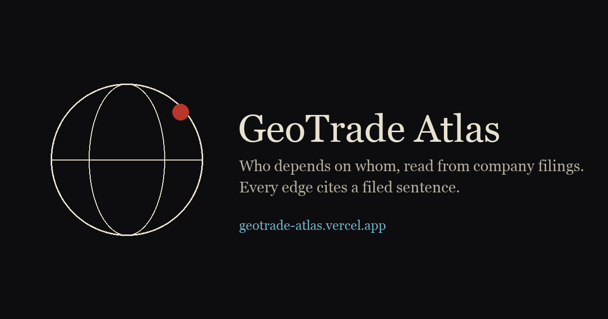
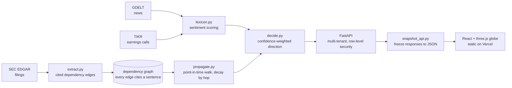

# GeoTrade Atlas

> Who depends on whom, read from company filings - and when something breaks, who it reaches next.

**Live:** https://geotrade-atlas.vercel.app &nbsp;·&nbsp; **Team:** Group G27, Department of Computer Engineering, Vishwakarma University, Pune



When something happens in the world - a port closes, a factory burns down, a country bans
an export - some companies are obviously affected and everyone already knows who they are.
The companies affected *next*, because they quietly buy something from the companies that
were hit, are much harder to find. Nobody has a list of them.

Atlas builds that list. Companies are required to tell the public certain things about
themselves, and buried in those documents are sentences like "two customers accounted for
41% of our revenue." We read thousands of those documents, work out who depends on whom,
and draw it on a map. When something happens, we show you the companies you would never
have thought to check - and for every single one, the exact sentence in the exact document
that proves the connection.

If we can't show you the sentence, we don't make the claim.

**We are not a trading product.** We tell you who is exposed and show you the evidence. We
never tell you what to buy or sell. [Why that matters](COMPLIANCE.md).

---

## Architecture

The pipeline reads primary documents, turns sentences into a cited graph, scores text against
a reviewable word list, and freezes the answers to static JSON the web app can serve with no
live backend.



The deployed site is a frozen snapshot: an HTTPS page cannot call `http://localhost`, so the
build calls the real API and writes its answers to `/data/v1/*.json`. The published site can
therefore never disagree with the one on a developer's machine. The cost is that data is
as-of the last build, not real-time.

## Tech stack, and why

| Layer | Choice | Why |
|---|---|---|
| Globe / UI | React 18 + TypeScript + Vite, `react-globe.gl` (three.js) | typed components; a 3D globe is the one view where "where" is the question |
| Sentiment | A hand-built finance lexicon, not an LLM | finance inverts ordinary sentiment ("beat", "charge"); a table is reproducible and has no prompt-injection surface |
| Extraction | Python regex + gazetteer over filing text | every edge must trace to a quotable sentence; a black box could not |
| API | FastAPI + psycopg | async, typed query params, easy row-level-security integration |
| Store | PostgreSQL + PostGIS | relational point-in-time reads (`valid_from`/`valid_to`) and geography for the globe |
| Hosting | Vercel static + frozen JSON | no server to cold-start or secure; the snapshot is the deploy artifact |
| CI | GitHub Actions + ephemeral Postgres | proves migrations idempotent and gates on "every edge cites a sentence" |

## Data sources

| Source | Used for | Link |
|---|---|---|
| SEC EDGAR | 10-K / 20-F filings, the dependency sentences | https://www.sec.gov/edgar |
| GDELT | streaming world news, matched to companies locally | https://www.gdeltproject.org |
| TIKR earnings-call transcripts | management commentary, scored like filings | provided for academic use by BuySellTips; not redistributed |

## Limitations and future work

- The buy/sell **direction is not yet validated against market returns** - only the graph's
  reach is backtested, honestly, as a regression over real events. The evaluation harness is
  written (`newsflow/evaluate_direction.py`): it grades the directional hit-rate against an
  always-up and a coin-flip baseline and runs the moment a `price_observation` feed is loaded.
  No price feed is licensed here, so it prints what it needs and exits until then.
- The globe (three.js) ships in the main bundle (~1.9 MB); lazy-loading it is the top perf win.
- Coverage is ten countries today; the extraction pipeline generalises but the universe is seeded.

---

## Running it

```bash
cp .env.example .env
make dev        # first time: Postgres + PostGIS + Redis, migrate, load the universe
make api        # read API on :8000
make web        # frontend on :5173
make demo       # re-record the walkthrough video

make up         # after a restart: brings Docker, the database and both servers back
```

Rebuild the universe from the raw market files:

```bash
python3 -I scripts/normalise_vendor_csv.py ../data   # dedupe, geocode, classify
make load && make gazetteer
```

Run the whole evidence layer, end to end:

```bash
make pipeline     # link-cik -> ingest -> extract -> propagate
make stats        # what is actually in the graph
```

`make help` lists everything.

## What exists today

Every number below came out of the database on the day it was written. `make eval`
reprints the graph figures; `eval/README.md` says how the quality ones were measured.

| | |
|---|---|
| **Reference layer** | **23,020 companies** across US, India, UK, Germany, Canada, Australia · 82,751 aliases · 51 sectors · 23,018 geolocated |
| **Gazetteer** | 51,059 usable aliases, **31,750 distinct match keys**, after suppressing names the corpus shows are generic rather than specific |
| **Schema** | 25 tables. Citation and tenancy enforced in the schema, not in review |
| **Tests** | **294 tests**, each written against something that could really break: 37 entity-merge rules · 34 API contract and abuse · 30 extractor regressions from real filing sentences · 27 data-integrity invariants · 25 gazetteer filter · 21 ingestion · 18 propagation walk · 16 browser end-to-end · 14 evaluation sampler · 13 tenant isolation · 12 migration · 12 alerts that must actually fire · 10 API-key handling · 10 propagation properties · 8 backtest gate · 7 proving the backtest cannot see the future |
| **Operations** | `make alerts` (ingest stopped, precision dropped, read path over budget), `make backtest` gating on a committed baseline, structured request logs, API keys, [docs/RUNBOOK.md](docs/RUNBOOK.md) |
| **API** | 5 ms median against a 200 ms budget. One relationship per row, with the number of citations that corroborate it |
| **Frontend** | 3D globe (night earth, density bins, propagation arcs), Live / Replay / Simulate, country → sector → company drill-down, citation component, evidence tier shown on every edge |
| **Evidence layer** | **225 real filings** from SEC EDGAR · 14,738 chunks with character offsets · 571 cited claims · **363 cited edges**, which are **207 distinct relationships** across 83 companies |
| **Measured precision** | **28 of 28 correct** where the filing states a percentage (exhaustive) · **68.3%** on a random sample of 60 where it only names a counterparty · [`eval/README.md`](eval/README.md) |
| **Measured attribution** | **Every displayed percentage (21 of 21) is the right number for the right company.** 7 further relationships are shown without a figure because the sentence does not permit safe attribution |
| **Measured recall** | Of 60 disclosure-shaped sentences read by hand, 5 name a company in our markets and we captured all 5. **48 of the 60 name nobody at all** - the ceiling on the whole method, and the reason the graph is small |
| **Events & exposure** | 26 real disruptions seeded · bounded 3-hop deterministic walk (the seed is hop 1, so two dependency edges are traversed) · **434 precomputed exposure rows** across a **26-event benchmark**, 54 of them more than one hop from the event |
| **Demo** | [`demo/atlas-demo.mp4`](demo/atlas-demo.mp4) - 3 minutes, recorded against the real app and database |
| **Not yet** | Stage two of extraction is deterministic rules, not an LLM - the interface is ready for one, and `eval/README.md` names the failures that need it. No customer conversations. See [docs/ROADMAP.md](docs/ROADMAP.md) for everything still open, named rather than quietly dropped |

### What the audit changed

Reading the cited sentences by hand took the graph from **62.5% precision to the
numbers above**, and it did so mostly by *removing* edges: 803 down to 207
distinct relationships. The worst defect it found was percentage attribution -
"our top five customers collectively accounted for 57%" was being copied onto
every company named in that sentence. Only 20 of 36 displayed percentages were
right. That was invisible until somebody read the filings.

**Links, ports, database access and how to show it to someone: [RUNNING.md](RUNNING.md).**

## Start here

| Doc | What it settles |
|---|---|
| [RUNNING.md](RUNNING.md) | URLs, ports, DB credentials, how to demo it |
| [docs/PROBLEM-STATEMENT.md](docs/PROBLEM-STATEMENT.md) | What we build, for whom, and the inversion the whole thing rests on |
| [docs/data-model.md](docs/data-model.md) | Every column we collect and why |
| [TEAM/demo-script.md](TEAM/demo-script.md) | The demo, narrated - 90 seconds, five minutes, and what to say when it breaks |
| [docs/coverage-universe.md](docs/coverage-universe.md) | Which companies, which market, which year - and why |
| [eval/README.md](eval/README.md) | **How good the extraction is, how we measured it, and what is still wrong** |
| [docs/RUNBOOK.md](docs/RUNBOOK.md) | The three alerts, what each means, and what to do when one fires |
| [TEAM/faq.md](TEAM/faq.md) | Every question we expect at the viva, and the honest answer |
| [TEAM/ownership.md](TEAM/ownership.md) | Who owns which area and what they must be able to do unaided |
| [docs/validation-week3.md](docs/validation-week3.md) | The experiment that tests our core assumption before we build on it |
| [docs/cost.md](docs/cost.md) | Measured cost of a full extraction. ~5,000 calls, one overnight run, ₹0 |
| [docs/sources.md](docs/sources.md) | Every data source, its licence, who verified it |
| [docs/research-prompts.md](docs/research-prompts.md) | How the team collects the remaining markets |
| [docs/ROADMAP.md](docs/ROADMAP.md) | 20 weeks, 6 phases, each ending in a demo |
| [docs/ARCHITECTURE.md](docs/ARCHITECTURE.md) · [docs/DESIGN.md](docs/DESIGN.md) · [docs/TEAM.md](docs/TEAM.md) | Stack, visual direction, who owns what |
| [COMPLIANCE.md](COMPLIANCE.md) | What we publish, what we refuse to touch, and why |
| [LEARN/glossary.md](LEARN/glossary.md) | Finance from zero. No term is used twice before it has an entry |
| [SUPERSEDED.md](SUPERSEDED.md) | Decisions we changed, and what changed them |

## Ground rules

- `main` is protected and always deployable. One approving review, squash merge.
- Secrets live in `.env`, never in git.
- Every claim traces to a sentence. `dependency_edge.chunk_id` is `NOT NULL`.
- The model extracts and explains. It never produces a score.
- Every graph read passes through `edges_as_of`. There is no second path.
- Numbers in these docs are marked `[measured]` or `[verify]`. Never publish an unmarked one.

## Attribution

Contains data from [GeoNames](https://www.geonames.org/), CC BY 4.0.
Globe textures from [three-globe](https://github.com/vasturiano/three-globe) (MIT); imagery
NASA Visible Earth (public domain) - see [apps/web/public/textures/SOURCE.md](apps/web/public/textures/SOURCE.md).
Company reference data from [SEC EDGAR](https://www.sec.gov/edgar), public domain.
US city coordinates from [US-Cities-Database](https://github.com/kelvins/US-Cities-Database), MIT.

## A note on `../reference/`

A captured copy of a third-party product studied before starting. Nothing from it ships -
see [`../reference/DO-NOT-SHIP.md`](../reference/DO-NOT-SHIP.md).
